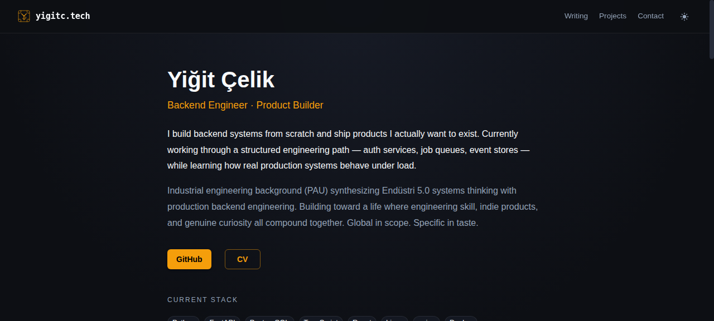

# yigitc.tech

**My personal site — live at [yigitc.tech](https://yigitc.tech)**



React + MUI, built with Create React App, deployed on GitHub Pages under a custom domain via a `CNAME` + `gh-pages` subtree push.

## What's on it

- **About** — who I am: backend engineer path (auth → job queue → event log), industrial engineering background (PAU), Endüstri 5.0 systems thinking
- **Path** — Backend / Data / ML engineering tracks I'm working through
- **Projects** — the real ones, honestly labelled: [Sentinel sovereign intelligence stack](https://yigitc.tech), [plotpoint.space](https://plotpoint.space), [auth-service](https://github.com/yigitckk/auth-service), [job-queue](https://github.com/yigitckk/job-queue), append-only event log (building)
- **CLI terminal block** — the actual status of my self-hosted stack (Vikunja task OS, Miniflux feeds, RAG engine, Glance hub), no fake numbers

## Build & deploy

```bash
npm run build                                  # → build/
git subtree push --prefix build origin gh-pages
# (or: git subtree split --prefix build → force push that SHA to gh-pages)
```

GitHub Pages serves the `gh-pages` branch with the `CNAME` file → https://yigitc.tech

## Design

Dark, terminal-first aesthetic: JetBrains Mono CLI block, slate palette, minimal chrome. The site is a business card for systems work — it shows the stack and the path, not a carousel.